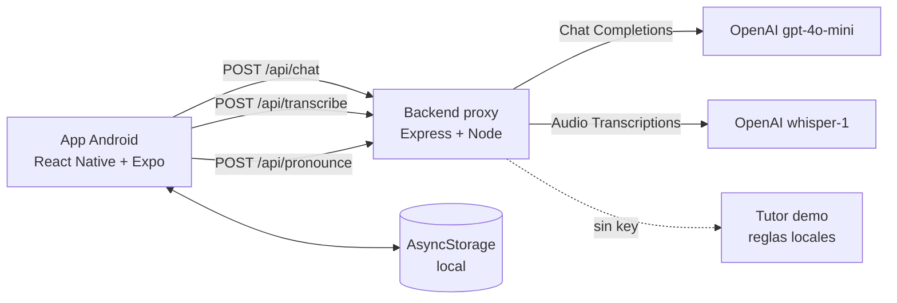

# Actualización del anteproyecto — LingoAI

> Documento de ajuste para la entrega final de **Computación Móvil (UdeA, 2026-2)**.
> Reemplaza las secciones 5, 6, 7 y 8 del anteproyecto original del 20 de agosto de 2026.
> Los objetivos (sección 3) y el alcance (sección 4) se mantienen, con el estado real de
> implementación indicado al final.

---

## 1. Cambio de stack: de Android nativo a React Native (Expo)

### Decisión

La aplicación se implementó con **React Native 0.88 sobre Expo SDK 58 + TypeScript**, con un
**backend proxy en Node.js** que encapsula las llamadas a OpenAI. No se usó Kotlin/Jetpack
Compose.

### Justificación

| Criterio | Kotlin + Compose (original) | React Native + Expo (elegido) |
| --- | --- | --- |
| Punto de partida | Reescribir todo desde cero | El prototipo de Figma ya era React: se reutilizó el diseño y los estilos |
| Entorno | Requiere Android Studio + SDK + Gradle | Solo Node + Expo Go en el celular |
| Pruebas en dispositivo | Compilar e instalar en cada cambio | Recarga en caliente por QR |
| Distribución | APK firmado manualmente | APK en la nube con EAS (`preview`) |
| Voz | APIs nativas de Android | `expo-audio` + Whisper, sin módulos nativos extra |
| Equipo | Curva de aprendizaje de Compose | Stack ya conocido por los dos integrantes |

**Conclusión:** el cambio no reduce funcionalidad; reduce el riesgo de cronograma. La app
resultante es un proyecto Android real (APK instalable), solo que con un runtime distinto.

### Lo que se conserva del anteproyecto

- Tutor conversacional con IA generativa, adaptado al nivel del estudiante.
- Entrada de texto y voz, con correcciones inmediatas y explicaciones ("breakdowns").
- Onboarding con evaluación inicial del nivel.
- Dashboard con métricas, racha y metas.
- Biblioteca de repaso (flashcards) generada de los errores.
- Seguimiento de progreso por habilidades.

### Lo que cambia en la arquitectura

La API key **no** se embebe en el APK (sería extraíble con `apktool`/Frida). Se añadió un
proxy que:

1. Guarda la credencial en el servidor (`.env`).
2. Construye el prompt pedagógico según nivel y modo.
3. Fuerza una respuesta JSON validable (sin *prompt injection* del cliente).
4. Aplica *fallback* a un tutor local si OpenAI falla, para que la demo nunca se caiga.

---

## 2. Sección 5 actualizada — Arquitectura y tecnologías

| Componente | Tecnología implementada |
| --- | --- |
| Plataforma | Android (APK generado con EAS) sobre React Native + Expo SDK 58 |
| Lenguaje | TypeScript 6 (app) y JavaScript ESM (backend) |
| Interfaz | React Native + componentes propios; sin librería de UI externa |
| Navegación | Estado de pestañas + `BackHandler` de Android |
| IA | API de OpenAI (`gpt-4o-mini`) a través de backend proxy en Express 5 |
| Voz (STT) | `expo-audio` para captura + `whisper-1` para transcripción |
| Voz (TTS) | `expo-speech` (motor del dispositivo, `en-US`) |
| Persistencia | `AsyncStorage` (nivel, chat, racha, métricas y flashcards) |
| Visualización | `react-native-svg` (anillos de progreso) y gráficos con `View` |
| Build | EAS Build (perfil `preview` → APK; `production` → AAB) |

### Diagrama

---

## 3. Sección 6 actualizada — Funcionalidades

### 6.1 Onboarding inteligente

- 5 preguntas de gramática y uso (A1 → C1).
- Puntaje 0–1 → Principiante (A1–A2); 2–3 → Intermedio (B1–B2); 4–5 → Avanzado (C1–C2).
- El estudiante puede ajustar el nivel manualmente; se explica el efecto del cambio.
- El nivel condiciona el prompt, el vocabulario, los ejercicios y las frases de
  pronunciación.

### 6.2 Dashboard

- Saludo contextual, nivel y racha.
- Lección recomendada según nivel.
- Meta diaria de 30 minutos con anillo de avance.
- Palabras nuevas del día y total histórico.
- Gráfico de minutos de los últimos 7 días (datos reales, no de ejemplo).

### 6.3 Chat tutor IA

- Modos: conversación libre, vocabulario, gramática, pronunciación y quiz.
- Tarjeta de corrección expandible: corrección, regla en español y ejemplo.
- Respuestas leídas en voz alta (TTS) con opción de silenciar.
- Historial persistente (últimos 120 mensajes).
- Indicador de "modo local" cuando el backend no responde.

### 6.4 Análisis de progreso

- Habilidades (vocabulario, gramática, pronunciación, comprensión) que **se mueven con la
  actividad**: una corrección sube gramática, un quiz sube gramática/comprensión, una
  grabación ajusta pronunciación.
- Estadísticas acumuladas: palabras, mensajes, correcciones, quizzes y mejor puntaje de
  pronunciación.
- Actividad semanal.

### 6.5 Biblioteca de repaso

- Flashcards creadas automáticamente a partir de `correction.word` y del vocabulario.
- Tarjeta con volteo 3D, definición y ejemplo; marca "error previo".
- Persistencia y deduplicación por palabra (máximo 60 tarjetas).

### 6.6 Gamificación

- Racha por días consecutivos (se reinicia si se rompe la cadena).
- Meta diaria y minutos acumulados con temporizador real de sesión.
- Logros/insignias: **pendiente (fase 2)**.

---

## 4. Sección 7 actualizada — Análisis técnico y desafíos

| Desafío del anteproyecto | Cómo se resolvió |
| --- | --- |
| **Prompt engineering** | Un *system prompt* por nivel y modo, con reglas explícitas de longitud, idioma, corrección y formato JSON. Se prohíbe markdown y se limita el rol. |
| **Latencia** | `gpt-4o-mini` con `max_tokens` acotado y solo 10 turnos de historial. El usuario ve un indicador de escritura; la voz se transcribe en una sola llamada. |
| **Contextualización** | El cliente envía historial reciente y el backend inyecta nivel y modo. El progreso y las flashcards persisten en el dispositivo. |
| **Costo** | Modelo pequeño, respuestas cortas, historial truncado. Configurable por `.env`. |
| **Seguridad de la credencial** | Proxy server-side; la app nunca ve la key. |
| **Disponibilidad en la demo** | *Fallback* local con reglas de error frecuentes (`goed`, `he don't`, `more better`…) y banner que informa el modo. |
| **Validación de la salida del LLM** | Parseo robusto de JSON (tolera texto alrededor), normalización de campos y descarte de correcciones sin `fix`. |
| **Puntaje de pronunciación** | No se le pide una nota al modelo (sería inconsistente): se transcribe y se alinea con LCS contra la frase objetivo; el puntaje es la proporción de palabras reconocidas y el feedback lista las fallidas. |
| **Permisos y audio** | `expo-audio` gestiona el permiso `RECORD_AUDIO` y el modo de audio; se restaura al terminar. |
| **HTTP en release** | Android 9+ bloquea tráfico en claro; se habilitó `usesCleartextTraffic` vía `expo-build-properties` para la demo con backend en LAN. En producción debe migrarse a HTTPS. |

---

## 5. Sección 8 actualizada — Cronograma ejecutado

| Fase | Actividad | Entregable | Estado |
| --- | --- | --- | --- |
| 1 | Diseño y arquitectura | Prototipo Figma + definición de stack y contrato de API | ✅ |
| 2 | Desarrollo del chat con IA | Chat de texto, backend proxy, prompts y correcciones | ✅ |
| 3 | Integración de voz | Grabación, transcripción y TTS | ✅ |
| 4 | Progreso y gamificación | Dashboard, métricas reales, rachas y flashcards | ✅ |
| 5 | Pruebas y ajustes | Pruebas de flujo, corrección de bugs, build APK | ✅ / en curso |

---

## 6. Estado real vs. alcance del anteproyecto

| Requisito del MVP | Estado |
| --- | --- |
| Registro e inicio de sesión | ⛔ No implementado. El perfil es local (nombre + nivel). Se propone Firebase Auth en fase 2. |
| Onboarding con evaluación inicial | ✅ Implementado con test y ajuste manual. |
| Chat de texto y voz | ✅ Texto con IA real; voz con Whisper + TTS. |
| Dashboard de progreso | ✅ Métricas reales. |
| Biblioteca de flashcards | ✅ Generadas de errores y vocabulario. |
| Gamificación (rachas, metas, logros) | ✅ Rachas y meta diaria; ⛔ logros/insignias. |

**Trabajo futuro:** autenticación y sincronización (Firebase), logros, notificaciones
locales para recordar la práctica, evaluación de pronunciación por fonemas (Forced
Alignment), modo sin conexión con modelo on-device y despliegue HTTPS del backend.

---

## 7. Cómo se sostiene la nota

| Criterio típico de la asignatura | Evidencia en el proyecto |
| --- | --- |
| App móvil funcional | APK instalable + flujo completo de 5 pantallas |
| Uso de hardware/servicios del dispositivo | Micrófono, altavoz (TTS), almacenamiento local, ciclo de vida y botón atrás |
| Persistencia | `AsyncStorage` con estado versionado |
| Consumo de servicios web | API REST propia + OpenAI |
| Buenas prácticas | TypeScript estricto, separación por capas, manejo de errores y *fallback*, sin secretos en el cliente |
| Diseño | Interfaz portada del prototipo, consistente y con estados vacíos/errores |
